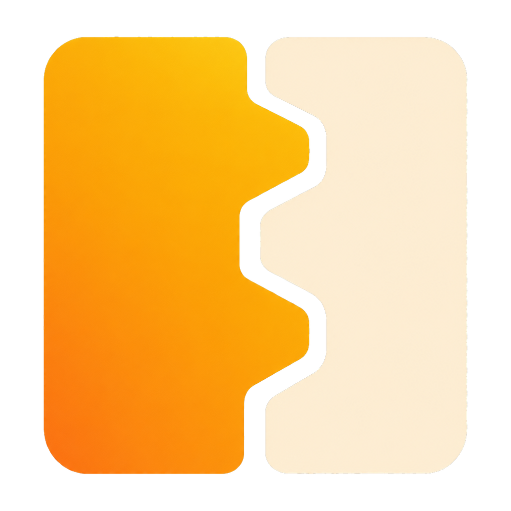

<p align="center">
  
</p>

<h1 align="center">Dovetail</h1>

<p align="center">
  Modular SwiftUI building blocks for iOS apps.<br>
  <em>Independent pieces, locked together.</em>
</p>

<p align="center">
  
  
  <a href="https://github.com/dmytro-ipatii/Dovetail/actions/workflows/ci.yml"></a>
  
  
</p>

Dovetail is an open-source collection of reusable SwiftUI modules for iOS apps. Every module is extracted from a real, shipping app, then made generic so it fits into yours. Each one is its own library product, so your app imports only what it needs. Like the woodworking joint it's named after, Dovetail holds together without glue.

## Requirements
- Swift 6.0+ (Xcode 16+)
- iOS 18+

## Installation
Add Dovetail with Swift Package Manager:

```swift
dependencies: [
    .package(url: "https://github.com/dmytro-ipatii/Dovetail.git", from: "0.1.0")
]
```

Then add only the products you need to your target:

```swift
.target(name: "MyApp", dependencies: [
    .product(name: "DovetailRouter", package: "Dovetail")
])
```

In an Xcode project, go to File → Add Package Dependencies…, enter the repository URL, and tick only the products you need.

Each module is imported on its own:

```swift
import DovetailRouter
```

## Modules
| Module | Description | Status |
| --- | --- | --- |
| [DovetailRouter](#dovetailrouter) | Imperative SwiftUI navigation: push, sheets, full screen covers, custom modals, alerts and confirmation dialogs. | Beta |

### DovetailRouter
Wrap the root of your app in a `DovetailRouterView`. It owns the `NavigationStack` and every presentation, and hands a router to its content:

```swift
import DovetailRouter

@main
struct MyApp: App {
    var body: some Scene {
        WindowGroup {
            DovetailRouterView { router in
                HomeView(router: router)
            }
        }
    }
}
```

Each new screen receives its own router, so it can keep routing:

```swift
router.showScreen(.push) { router in
    DetailView(router: router)
}

router.showScreen(.sheet) { router in
    SettingsView(router: router)
}

router.showModal {
    RatingPrompt()
}

router.showAlert(content: AlertContent(
    title: "Delete item?",
    message: "This can't be undone.",
    actions: [
        ButtonContent(label: "Cancel", role: .cancel) {},
        ButtonContent(label: "Delete", role: .destructive) { deleteItem() }
    ]
))
```

The router passed to `content` is a `Router`, a protocol you can depend on in your views and view models. Nested views can also read it from the environment with `@Environment(\.dovetailRouter)`. In previews and tests, use `MockRouter`, which logs calls instead of presenting anything.

## Documentation
Per-module DocC documentation will be hosted on the [Swift Package Index](https://swiftpackageindex.com/dmytro-ipatii/Dovetail/documentation). To browse it locally, open the package in Xcode and choose Product → Build Documentation.

## Contributing
Contributions are welcome. See [CONTRIBUTING.md](CONTRIBUTING.md) and the [Code of Conduct](CODE_OF_CONDUCT.md).

## License
[MIT License](LICENSE).
